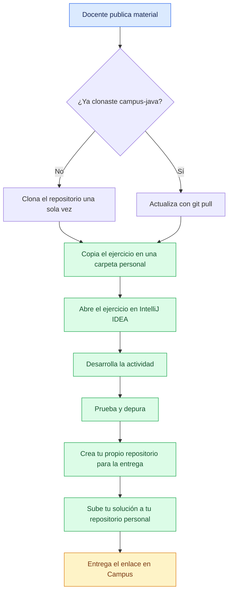
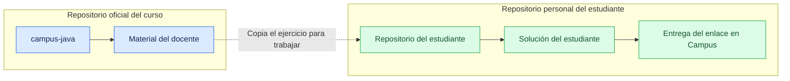
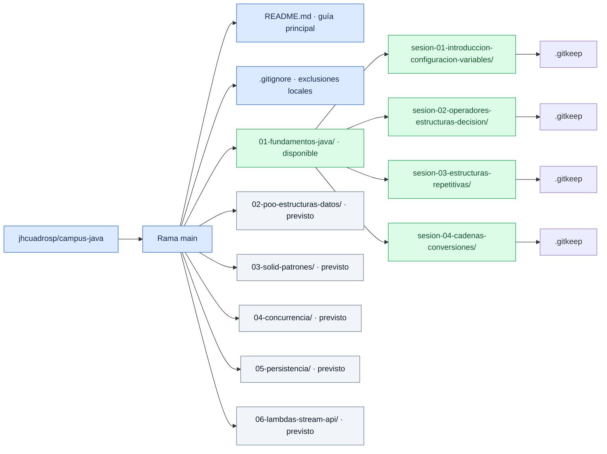

# Campus Java

Repositorio oficial del curso de Java con ejemplos, material de clase y laboratorios organizados por módulos y sesiones. Esta estructura inicial se completará con material a medida que avance el curso.

> **El repositorio campus-java es para recibir material; tu repositorio personal es para entregar tu trabajo.**

**Repositorio oficial:** [jhcuadrosp/campus-java](https://github.com/jhcuadrosp/campus-java) · **IDE del curso:** IntelliJ IDEA · **Entregas:** sistema Campus

## Guía de lectura

- [Propósito del repositorio](#propósito-del-repositorio)
- [Forma de trabajo](#forma-de-trabajo-con-el-repositorio-campus-java)
- [Herramientas del curso](#herramientas-del-curso)
- [Flujo básico](#flujo-básico)
- [Preguntas clave](#preguntas-clave)
- [Actualizar el material](#actualizar-el-material)
- [Buenas prácticas](#buenas-prácticas)
- [Estructura y módulos del curso](#estructura-del-repo-docente-de-ejemplo)

## Propósito del repositorio

Este repositorio se utiliza para:

- Distribuir material oficial del curso.
- Compartir ejemplos desarrollados por el docente.
- Publicar ejercicios y laboratorios.
- Mantener una estructura organizada de las sesiones.
- Permitir que los estudiantes actualicen el material mediante Git.

## Forma de trabajo con el repositorio campus-java

El repositorio `campus-java` será el **repositorio oficial del curso**. Allí estarán disponibles los ejemplos, ejercicios iniciales y laboratorios de cada sesión.

1. Clona el repositorio una sola vez. En GitHub, copia su URL desde el botón **Code** y ejecuta `git clone https://github.com/jhcuadrosp/campus-java.git` usando esa URL.
2. En clases posteriores, abre una terminal dentro de la carpeta `campus-java` y actualiza el material con:

   ```bash
   git pull
   ```

3. El repositorio del docente se considera material oficial de solo lectura en condiciones normales.
4. No subas aquí tus soluciones.
5. Desarrolla tus soluciones y entregas en repositorios personales, fuera de la carpeta del repositorio oficial.
6. Entrega el enlace de tu repositorio personal mediante el sistema Campus.
7. Los Pull Requests al repositorio oficial se usarán solo para contribuciones excepcionales, como correcciones o mejoras solicitadas por el docente.

> **El repositorio campus-java es para recibir material; tu repositorio personal es para entregar tu trabajo.**

## Herramientas del curso

- **Java JDK:** permite compilar y ejecutar programas Java.
- **IntelliJ IDEA:** IDE oficial del curso para escribir, ejecutar y depurar código.
- **Git:** permite clonar y actualizar los repositorios.
- **GitHub:** aloja el material oficial y los repositorios personales.

En los módulos iniciales **no se utilizará Maven ni Gradle**. Estas herramientas se introducirán cuando sean necesarias, especialmente al llegar a Spring Boot.

## Flujo básico

El flujo normal será:



**De esta manera tenemos una separación clara:**



| Espacio | Qué contiene | Cómo lo usas |
| --- | --- | --- |
| `campus-java` | Material oficial publicado por el docente | Clonas una vez y actualizas con `git pull` |
| Tu repositorio personal | Tu actividad desarrollada, probada y depurada | Subes tu solución y compartes el enlace |
| Sistema Campus | El enlace a tu repositorio personal | Registras la entrega según las indicaciones del docente |

## Preguntas clave

**¿Hay que descargar el repositorio cada clase? → NO.**

Clónalo una sola vez, reemplazando `URL_DEL_REPOSITORIO` por la URL del repositorio oficial:

```bash
git clone URL_DEL_REPOSITORIO
```

En las siguientes clases, actualiza la copia existente desde la carpeta `campus-java`:

```bash
git pull
```

**¿Antes de comenzar un laboratorio debe actualizarse el repositorio? → SÍ.**

Desde la carpeta del repositorio oficial, ejecuta:

```bash
git pull
```

**¿Se recomienda trabajar en una copia en una carpeta personal? → SÍ.**

Copia el ejercicio a una carpeta personal fuera de `campus-java` y trabaja allí. Esto evita que un futuro `git pull` encuentre cambios personales mezclados con el material oficial. Sube tu solución a tu repositorio personal y entrega su enlace en Campus.

## Actualizar el material

### Primera vez: clonar

Abre una terminal en la carpeta donde guardarás el material del curso:

```bash
git clone https://github.com/jhcuadrosp/campus-java.git
cd campus-java
```

### Antes de cada clase o laboratorio: actualizar

Desde una terminal ubicada dentro de la carpeta del repositorio oficial, ejecuta:

```bash
git pull
```

- `git clone`: se usa la primera vez para obtener una copia local del repositorio.
- `git pull`: se usa para actualizar un repositorio ya clonado con el material publicado por el docente.

## Buenas prácticas

- No modificar directamente el material oficial salvo indicación del docente.
- Mantener las soluciones personales fuera del repositorio oficial.
- Leer el README de cada sesión, cuando esté disponible, antes de iniciar.
- Ejecutar y depurar el código antes de entregar.
- No subir archivos compilados ni configuraciones personales del IDE.
- Utilizar nombres claros para repositorios y archivos.

## Estructura del repo docente de ejemplo

Así se organiza `jhcuadrosp/campus-java`, en la rama `main`. El diagrama integra los archivos principales, las cuatro sesiones actuales de fundamentos y los módulos previstos para las siguientes etapas del curso.



**Disponible:** la estructura del módulo `01-fundamentos-java` y sus cuatro primeras sesiones. **Previsto:** los módulos 02 a 06, que se incorporarán conforme avance el curso; sus carpetas todavía no existen.

| Sesión de fundamentos | Tema |
| --- | --- |
| 01 | Introducción, configuración y variables |
| 02 | Operadores y estructuras de decisión |
| 03 | Estructuras repetitivas |
| 04 | Cadenas y conversiones |

Cada sesión contiene inicialmente solo un archivo vacío `.gitkeep` para que Git pueda versionar la estructura de carpetas. Cada sesión tendrá posteriormente su propio README.

Más adelante se agregarán carpetas públicas `demo/` y `labs/` con ejemplos y actividades. En esta fase todavía no se crean esas carpetas ni archivos Java.
