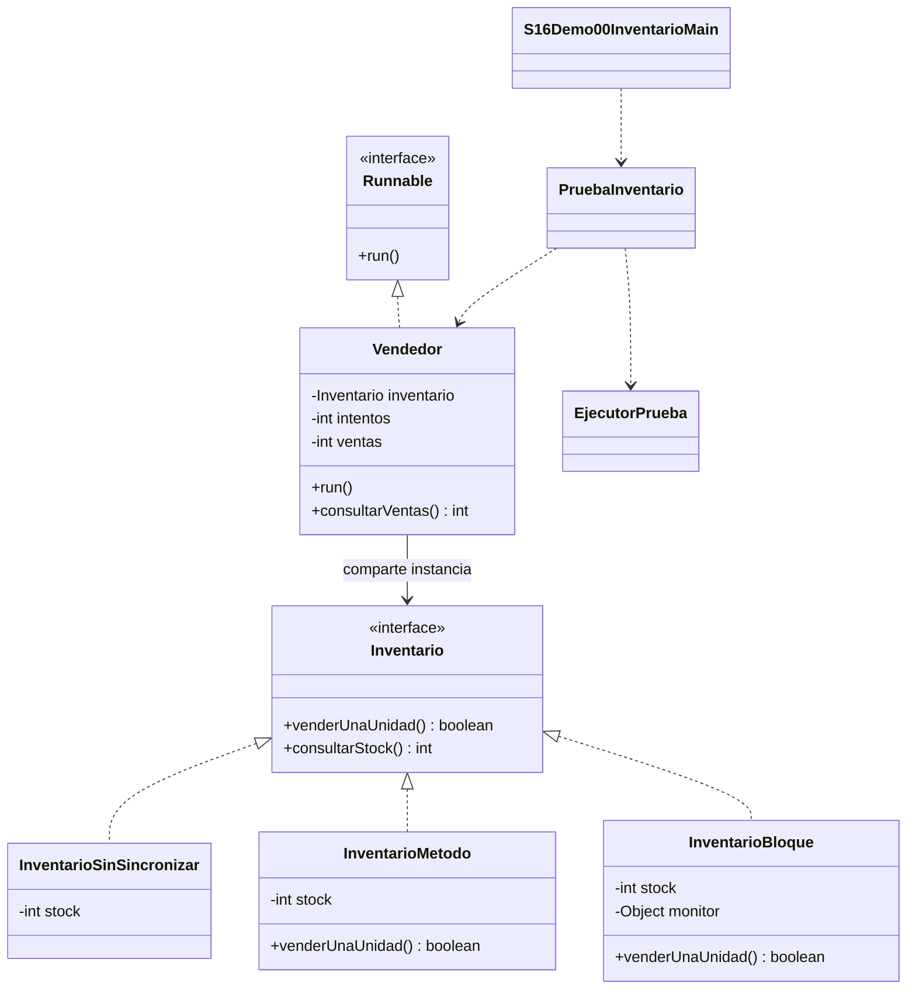
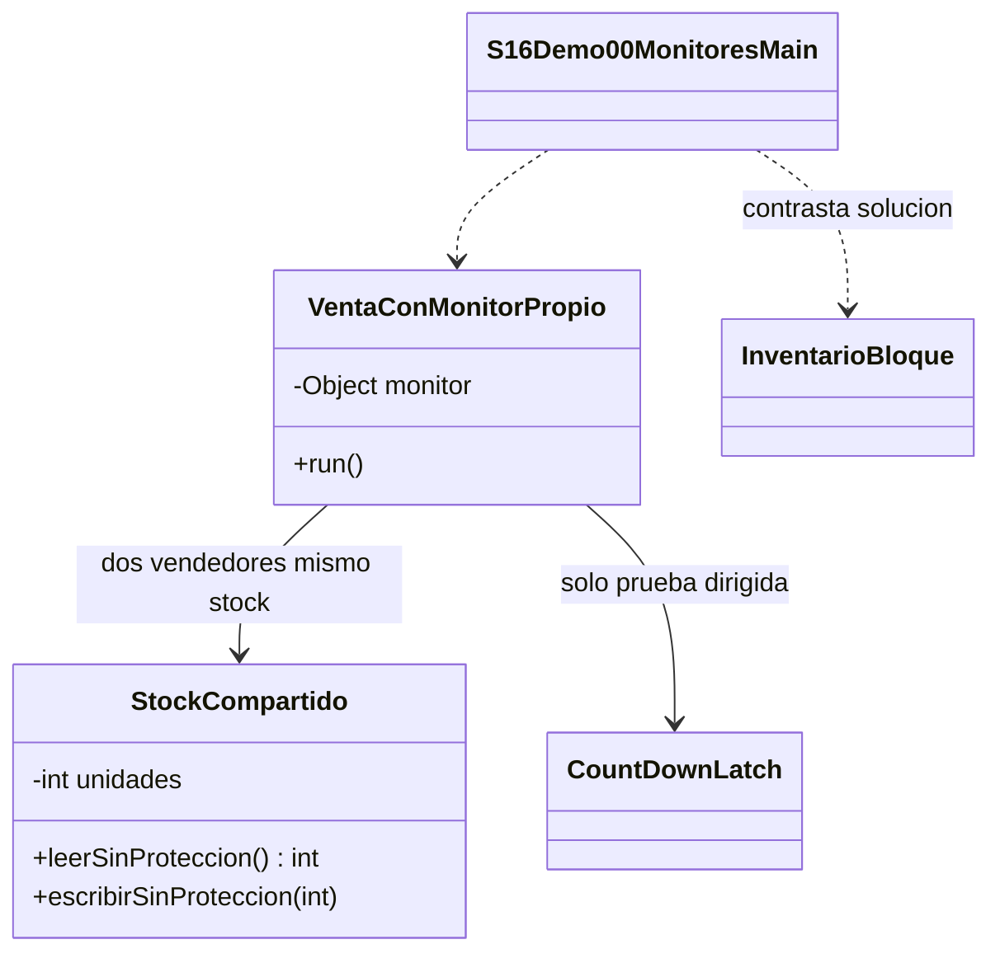

# Demo 00 · Un inventario, tres formas de acceso · 28 minutos

**Problema:** una tienda tiene 100 computadores. Dos vendedores venden una unidad cada uno. Deben quedar 98; si ambos leen 100 antes de escribir, pueden dejar 99.

No cambiaremos de problema para aprender cada sintaxis. Las tres versiones implementan Inventario y usan los mismos Vendedor y PruebaInventario.

## 1. Comprender el recurso y la operación

Lee [Inventario.java](Inventario.java), [Vendedor.java](Vendedor.java) y las tres implementaciones:
[sin sincronización](InventarioSinSincronizar.java), [método synchronized](InventarioMetodo.java) y [bloque privado](InventarioBloque.java).

Cada vendedor recibe **la misma instancia** de inventario. Su contador de ventas es propio y main lo lee después de esperar a todos. El recurso compartido es stock; la sección crítica es comprobar stock y descontar juntos.

| Versión | Monitor | Qué observar |
| --- | --- | --- |
| Sin sincronización | Ninguno | Lectura y escritura pueden intercalarse; un resultado correcto aislado no prueba seguridad |
| Método synchronized | this, la instancia de inventario | Todas las llamadas al método sobre esa instancia coordinan |
| Bloque synchronized | private final Object monitor | Solo la operación dependiente se protege, usando el mismo objeto estable |

También consultarStock usa el monitor correspondiente en las versiones correctas. Preparación de tareas, sumas de resultados y consola quedan fuera de la sección crítica. No saques la comprobación stock > 0 del bloqueo para hacerlo más pequeño.

## 2. Ejecutar la comparación progresiva

Abre [S16Demo00InventarioMain.java](S16Demo00InventarioMain.java) y ejecuta **Run → S16Demo00InventarioMain**.

1. Predice el caso pequeño: 100 unidades, dos vendedores y un intento por vendedor.
2. Compara las tres versiones. Método y bloque deben dejar stock=98, ventas=2 y rechazos=0.
3. Observa tres pruebas con cuatro vendedores y 1000 intentos cada uno. Todas comienzan con stock nuevo de 10000: las versiones correctas dejan 6000 y registran 4000 ventas.
4. Observa agotamiento: stock 100, dos vendedores con 80 intentos. Método y bloque deben dejar stock 0, ventas100 y rechazos60.
5. Localiza la validación de PruebaInventario: stockInicial = ventas + stockFinal; no negativos, sobreventa ni reservas inexplicablemente rechazadas cuando todavía debía existir stock.

### Resultados de las versiones correctas

```text
Metodo: stock=98 ventas=2 rechazos=0 coherente=true
Bloque: stock=98 ventas=2 rechazos=0 coherente=true
```

En cada prueba de carga:

```text
Metodo: stock=6000 ventas=4000 rechazos=0 coherente=true
Bloque: stock=6000 ventas=4000 rechazos=0 coherente=true
```

Al agotarse:

```text
Agotamiento metodo: stock=0 ventas=100 rechazos=60 coherente=true
Agotamiento bloque: stock=0 ventas=100 rechazos=60 coherente=true
```

**Sin proteger** imprime el valor observado y coherente=true/false; no hay un número defectuoso obligatorio. El programa no inventa una pérdida si esa ejecución dio correctamente.

## UML de la comparación



## 3. Por qué deben usar el mismo monitor

Ejecuta [S16Demo00MonitoresMain.java](S16Demo00MonitoresMain.java). Lee [VentaConMonitorPropio.java](VentaConMonitorPropio.java) y [StockCompartido.java](StockCompartido.java).

Dos vendedores comparten stock, pero **cada vendedor crea su propio monitor**. Ambos pueden entrar a sus bloques al mismo tiempo. La prueba preparada espera a que ambos hayan leído 100 y solo entonces permite que escriban 99.

```text
Mismo monitor: false
Intercalacion dirigida: esperado=98 observado=99
Monitor del inventario: stock=98 ventas=2 rechazos=0 coherente=true
```

Es una **intercalación dirigida** para entender el fallo, no una predicción de toda ejecución natural. El objeto CountDownLatch solo prepara la reproducción. No se usa como solución al inventario.

**No copies esa espera dentro del bloque correcto de un mismo monitor:** el primer hilo esperaría al segundo, que no podría entrar. Los casos correctos no esperan otra tarea mientras poseen el bloqueo.



## 4. static synchronized · ejemplo breve, sin lab

Ejecuta [S16Demo00StaticMain.java](S16Demo00StaticMain.java) y lee [Numerador.java](Numerador.java).

```text
Identificadores distintos: 2
Monitor: Numerador.class
```

El método static synchronized adquiere Numerador.class; un método synchronized de instancia adquiere this. No coordinan entre sí automáticamente. El objeto Class se entiende para esa clase y su cargador, no como un bloqueo global de cualquier código en la JVM.

## Comprobación y límites

EjecutorPrueba inicia las tareas mediante una señal común, espera terminación, recoge fallos y aplica plazos. No oculta excepciones de trabajadores como si fueran actualizaciones perdidas. Ese apoyo ya está preparado.

En Debug, coloca un breakpoint en venderUnaUnidad. Observa qué instancia de inventario comparte cada vendedor y qué monitor corresponde. Las pausas cambian la planificación: no valides rendimiento ni exijas ver una carrera espontánea bajo Debug.

**Ventaja:** conservar la regla de venta como una unidad. **Costo:** los hilos que necesitan el mismo monitor deben esperar; no implica reparto justo. **Cuándo evitarlo:** si cada tarea modifica datos propios, no hace falta un bloqueo compartido para esos datos.

[Volver a la sesión](../../README.md)
